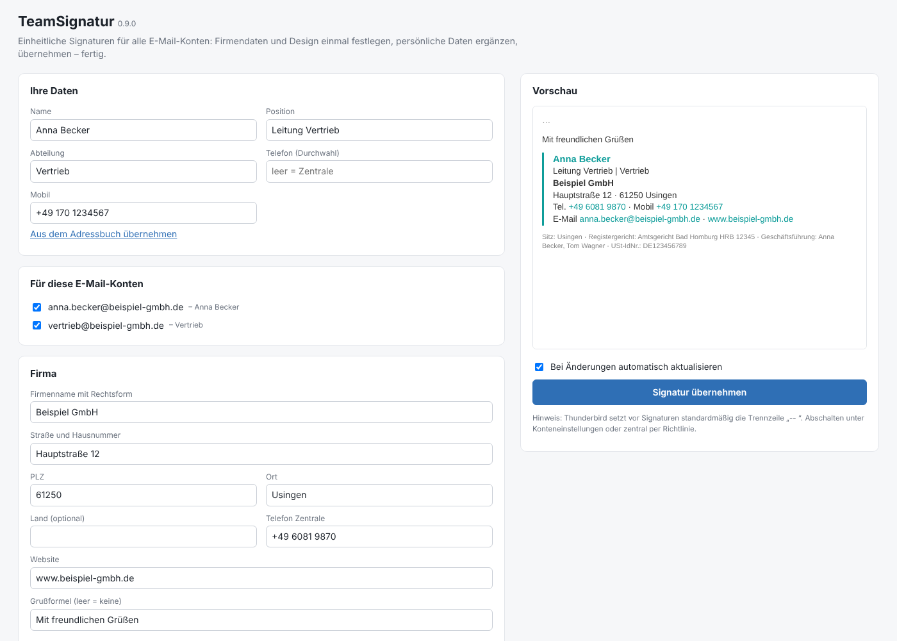

# TeamSignatur für Thunderbird (Beta)

**Einheitliche Firmen-E-Mail-Signaturen – wie aus einem Guss.**
Firmendaten, Logo, Pflichtangaben und Design einmal festlegen, persönliche Daten
ergänzen, übernehmen. Die IT kann die Firmenvorlage zentral vorgeben.

> ⚠️ **Beta.** Vorhandene Signaturen werden beim Übernehmen ersetzt – bitte vorher
> sichern. Fehler und Ideen gern als [Issue](https://github.com/Stefan2706/teamsignatur/issues).

## Funktionen
- **Drei Designs**: Klassisch, Modern mit Logo, Kompakt – mit Live-Vorschau
- **Firmendaten und Logo**, Akzentfarbe, Schrift und Schriftgröße in pt
- **Pflichtangaben** für Geschäftsbriefe per E-Mail (Sitz, Registergericht,
  Registernummer, Geschäftsführung, USt-IdNr.) und optionaler Zusatztext
- **Persönliche Daten** (Name, Position, Abteilung, Durchwahl, Mobil) – auch per
  Klick aus dem Adressbuch, z. B. aus dem Firmenadressbuch in Nextcloud
- **Für mehrere E-Mail-Konten** auf einmal, E-Mail-Adresse jeweils automatisch
- **Automatisch aktuell**: Ändert sich die Vorlage, werden die Signaturen angepasst
- **Zentrale Vorgabe durch die IT** per Thunderbird-Richtlinie oder JSON-Datei
- Nutzt nur offizielle Thunderbird-Schnittstellen – keine Experiment-API
- Deutsch und Englisch, helles und dunkles Design

## Installation
`teamsignatur-x.y.z.xpi` unter [Releases](https://github.com/Stefan2706/teamsignatur/releases)
herunterladen → Thunderbird → Add-ons und Themes → Zahnrad → **Add-on aus Datei
installieren**. Geöffnet wird TeamSignatur über den Symbolleisten-Button, das Menü
**Extras** oder die Add-on-Einstellungen. Für Linux gibt es zusätzlich ein `.deb`.

## Zentrale Vorgabe für Unternehmen
1. Vorlage einmal in TeamSignatur gestalten und unter *Zentrale Vorgabe →
   Vorlage exportieren* kopieren.
2. Verteilen – wahlweise:
   - **Thunderbird-Richtlinie** (`policies.json`, Abschnitt `3rdparty`): Die Vorlage
     ist dann für Mitarbeitende gesperrt. Beispiel: [docs/richtlinie-beispiel.json](docs/richtlinie-beispiel.json)
     – installiert das Add-on gleich mit und schaltet die Trennzeile „-- “ ab.
   - **JSON-Datei im Firmennetz** (Webserver, Nextcloud-Freigabelink): Adresse in
     TeamSignatur unter *Zentrale Vorgabe* eintragen. Beispiel: [docs/beispiel-vorlage.json](docs/beispiel-vorlage.json)
3. Mitarbeitende ergänzen nur ihre persönlichen Daten und klicken auf *Übernehmen*.

## Datenschutz
TeamSignatur sendet keine Daten. Netzwerkzugriffe gibt es nur für die Update-Prüfung
bei GitHub und – falls eingerichtet – zum Laden der zentralen Vorlage.

## Rechtlicher Hinweis
Die Felder für Pflichtangaben sind eine Hilfe, keine Rechtsberatung. Welche Angaben
nötig sind, hängt von Rechtsform und Land ab.

## Lizenz
[Mozilla Public License 2.0](LICENSE) · © Stefan Scherer, [ts-scherer.com](https://ts-scherer.com)
